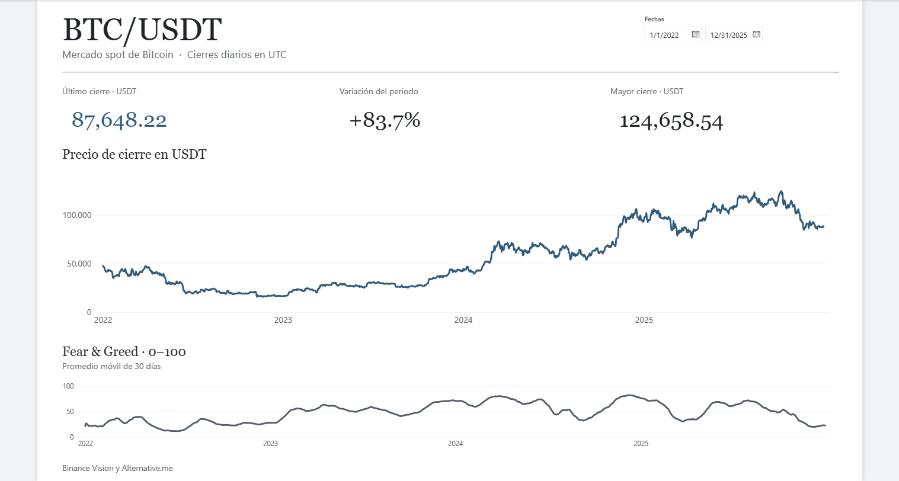
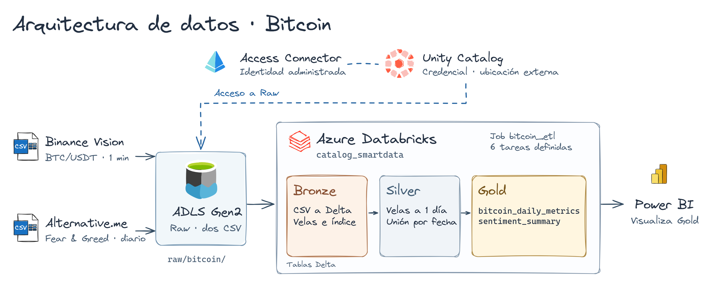
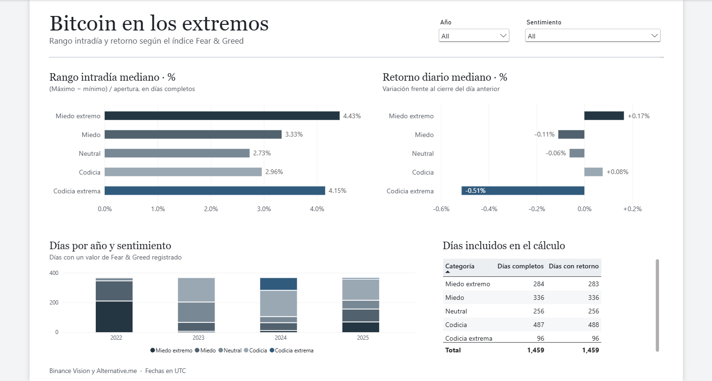
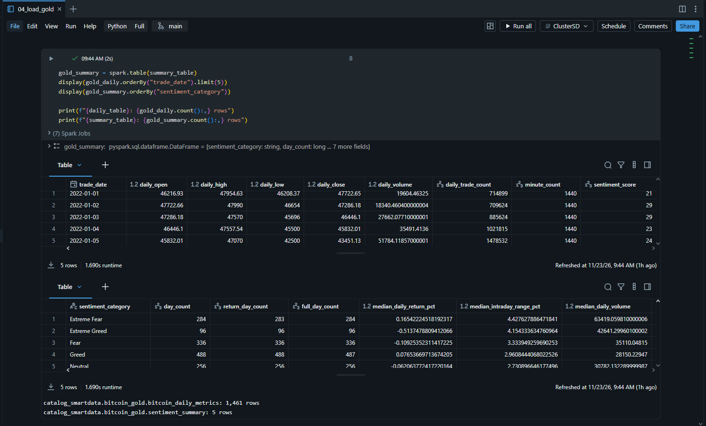

# Bitcoin y sentimiento del mercado

Proyecto de ingeniería de datos sobre BTC/USDT entre 2022 y 2025. Azure Databricks procesa las velas de Binance Vision y las cruza por fecha con el índice Fear & Greed de Alternative.me. El resultado se consulta en Power BI.

El alcance actual comprende la preparación del ambiente, el ETL de Raw a Gold y el [informe de Power BI](dashboard/bitcoin_sentimiento.pbix).

## ¿Qué preguntas responde?

- ¿Cómo cambió el cierre de Bitcoin en el periodo seleccionado?
- ¿Qué categorías de sentimiento coinciden con mayor rango intradía?
- ¿Cuántos días respaldan cada comparación y cómo se distribuyen por año?

## Arquitectura

[Diagrama editable en Excalidraw](evidencias/architecture.excalidraw)

Azure Databricks lee Raw mediante una ubicación externa de Unity Catalog. La credencial de almacenamiento usa la identidad administrada de un Access Connector. Las tablas se registran en el catálogo `catalog_smartdata`.

Para habilitar el acceso a Raw se asigna el rol `Storage Blob Data Contributor` a la identidad administrada del Access Connector. La ubicación externa cubre `abfss://delta-lake@adlsmartdata0811.dfs.core.windows.net/raw/bitcoin` y la cuenta que ejecuta la ingesta necesita `READ FILES`. [Hoja de aprovisionamiento](certificaciones/03-databricks-aprovisionamiento.pdf)

| Capa | Tablas | Qué se hace |
| --- | --- | --- |
| Bronze | `bitcoin_bronze.binance_prices`, `bitcoin_bronze.fear_greed_index` | Se cargan los dos CSV y se conservan los valores de origen. |
| Silver | `bitcoin_silver.binance_minutes`, `bitcoin_silver.bitcoin_daily` | Se unifican las marcas de tiempo en UTC, se quitan duplicados y se unen el mercado y el sentimiento por fecha. |
| Gold | `bitcoin_gold.bitcoin_daily_metrics`, `bitcoin_gold.sentiment_summary` | Se calculan el retorno diario y el rango intradía. Se resumen las métricas en cinco categorías de sentimiento. |

## Datos y resultados

| Dato | Cobertura |
| --- | --- |
| Velas BTC/USDT de Binance | 2.103.760 registros de un minuto en 48 archivos mensuales. |
| Fear & Greed de Alternative.me | 1.460 valores diarios. |
| Métricas diarias de Gold | 1.461 fechas de mercado. El cruce conserva una fecha sin sentimiento. |
| Resumen de sentimiento de Gold | Cinco categorías. El rango intradía mediano usa los días con 1.440 velas. |

El [directorio de datasets](datasets/README.md) detalla las fuentes, archivos incluidos y rutas de carga en ADLS.

## Ejecución en Azure Databricks

1. Se cargan los dos CSV completos en `delta-lake/raw/bitcoin/`, en las subcarpetas de cada fuente. La ubicación externa debe tener acceso a esta ruta con la identidad administrada.
2. En la carpeta Git de Azure Databricks se selecciona un clúster con acceso a Unity Catalog y se ejecutan los notebooks en este orden. Los widgets incluyen los valores del ambiente del proyecto. Los notebooks de producción están en `proceso/` en formato `SOURCE` (`.py`), el formato que usa `script3.yml` en el despliegue de la sesión 13.

   | Orden | Notebook | Resultado |
   | --- | --- | --- |
   | 1 | [00_prepare_environment.py](proceso/00_prepare_environment.py) | Comprueba los CSV en Raw y crea los esquemas. |
   | 2 | [01_ingest_binance.py](proceso/01_ingest_binance.py) | Carga las velas en Bronze. |
   | 3 | [02_ingest_fear_greed.py](proceso/02_ingest_fear_greed.py) | Carga el índice de sentimiento en Bronze. |
   | 4 | [03_transform_silver.py](proceso/03_transform_silver.py) | Obtiene las velas normalizadas y la serie diaria. Muestra las fechas con datos incompletos. |
   | 5 | [04_load_gold.py](proceso/04_load_gold.py) | Crea las dos tablas para el análisis. |
   | 6 | [05_grant_gold_access.py](proceso/05_grant_gold_access.py) | Aplica y comprueba los permisos de Gold. |

3. Se abre [bitcoin_sentimiento.pbix](dashboard/bitcoin_sentimiento.pbix) en Power BI Desktop. El archivo incluye una copia importada de las tablas Gold. Para actualizarla, Power BI requiere acceso al entorno de Azure Databricks.

## Orquestación

La [definición del Job](orquestacion/wf_bitcoin.json) sigue las dependencias de `wf_structure.txt` de la sesión 13. El flujo es **preparación → dos ingestas en paralelo → Silver → Gold → permisos**. En el curso, `script3.yml` crea y ejecuta el Job por API.

Para la primera prueba se sincroniza la carpeta Git y se crea `bitcoin_etl` en **Jobs & Pipelines**. Las seis tareas son de tipo **Notebook** con fuente **Workspace** y cómputo `ClusterSD`. Los notebooks y las dependencias están en el JSON. Para crear el Job por API se completan `<CLUSTER_ID>` y `<WORKSPACE_REPO_PATH>` con los valores del workspace.

Se pulsa **Run now** y se comprueba el estado de las seis tareas en **Runs**. `load_gold` debe mostrar 1.461 filas diarias y 5 categorías. La última tarea muestra los permisos de `bitcoin_readers`.

## Seguridad

El grupo de cuenta `bitcoin_readers` está asignado al workspace. El Job ejecuta [05_grant_gold_access.py](proceso/05_grant_gold_access.py) después de Gold. El [notebook de permisos](seguridad/grant_gold_access.ipynb) también se puede ejecutar por separado con `ClusterSD`. Las dos últimas celdas muestran `SHOW GRANTS` y permiten comprobar `SELECT` en cada tabla. [Captura del grupo](evidencias/bitcoin_readers_group.png)

## Reversión

El notebook [rollback_medallion.ipynb](reversion/rollback_medallion.ipynb) muestra el tipo y la ruta de las seis tablas de Bitcoin. Con `drop_tables = False` se ejecuta la revisión. Para eliminar las tablas administradas se cambia el valor a `True` y se ejecuta la celda. Si encuentra otro tipo de tabla, se detiene antes de borrar.

Unity Catalog realiza la limpieza de los archivos de las tablas administradas después del periodo de recuperación. Para volver a cargar las tablas se ejecutan los notebooks `01` a `05` en orden, a partir de los CSV de Raw.

## Power BI

- **Mercado** muestra el cierre diario, las cifras del periodo y la evolución de Fear & Greed. El índice usa un promedio móvil de 30 días. El volumen y el rango intradía se ven en el detalle del cierre.
- **Sentimiento** compara el rango intradía y el retorno diario con filtros de año y categoría.

El rango intradía se calcula como la diferencia entre el máximo y el mínimo dividida entre la apertura. Para su mediana se usan días con 1.440 velas. El retorno diario compara el cierre con el día anterior. El índice incorpora la volatilidad de Bitcoin, por lo que la comparación describe el mismo periodo. [Metodología de Alternative.me](https://alternative.me/crypto/fear-and-greed-index/#data-sources)

## Evidencias

La ejecución de Gold en Databricks muestra **1.461 filas** en `bitcoin_daily_metrics` y **5 filas** en `sentiment_summary`. También están disponibles las capturas del [cálculo diario](evidencias/gold_daily_metrics.png) y del [resumen por sentimiento](evidencias/gold_sentiment_summary.png).

## Certificaciones

Las cinco [hojas de consulta](certificaciones/) se prepararon durante el curso para estudiar y rendir más adelante los exámenes de certificación de Databricks. Cubren PySpark y SQL, ETL, aprovisionamiento, Unity Catalog y Delta Lake.
