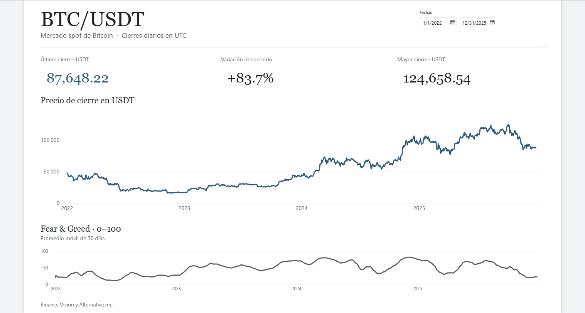
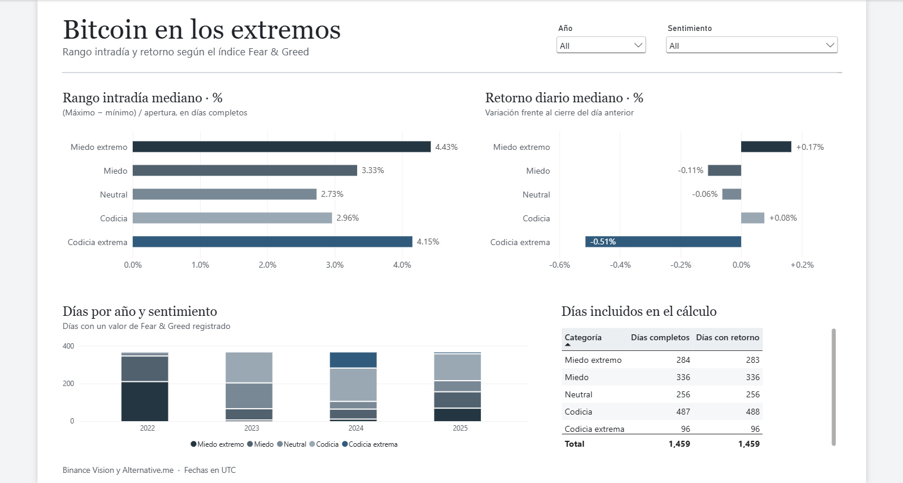

# Bitcoin y sentimiento en Power BI

El [informe editable](bitcoin_sentimiento.pbix) utiliza las tablas `bitcoin_daily_metrics` y `sentiment_summary` de `catalog_smartdata.bitcoin_gold`. El archivo incluye los datos importados de 2022 a 2025.

## Mercado

El filtro **Fechas** actualiza el último cierre, la variación entre el primer y el último cierre y el mayor cierre del periodo. También ajusta el gráfico de precio y la evolución del índice Fear & Greed, que se presenta como promedio móvil de 30 días. El detalle de cada cierre muestra el volumen negociado y el rango intradía.

## Sentimiento

Los filtros **Año** y **Sentimiento** se pueden combinar. Los gráficos recalculan las medianas del rango intradía y del retorno diario. El gráfico inferior cuenta los días por año y categoría, y la tabla muestra el tamaño de la muestra de cada cálculo.

El rango intradía se calcula como la diferencia entre el máximo y el mínimo dividida entre la apertura. Su mediana usa días con 1.440 velas. El retorno diario compara el cierre con el del día anterior. El índice incorpora la volatilidad de Bitcoin, así que la comparación describe el mismo periodo. [Metodología de Alternative.me](https://alternative.me/crypto/fear-and-greed-index/#data-sources)

Los datos proceden de [Binance Vision y Alternative.me](../datasets/README.md). Las fechas se agrupan en UTC.
