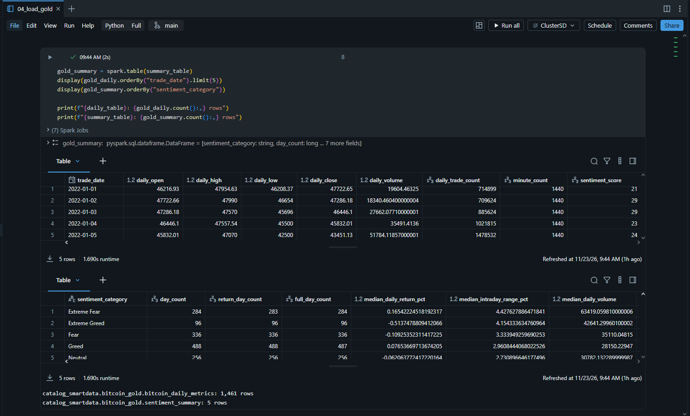

# Evidencias y material de consulta

## Ejecución de Gold

La salida de [04_load_gold.ipynb](../proceso/04_load_gold.ipynb) en Databricks muestra **1.461 filas** en `bitcoin_daily_metrics` y **5 filas** en `sentiment_summary`, en el esquema `catalog_smartdata.bitcoin_gold`.

- [Métricas diarias](gold_daily_metrics.png). Cálculo del retorno, rango intradía y día completo, seguido de la escritura de `bitcoin_daily_metrics`.
- [Resumen por sentimiento](gold_sentiment_summary.png). Agrupación por categoría y escritura de `sentiment_summary`.

El [informe de Power BI](../dashboard/README.md) incluye las capturas de Mercado y Sentimiento.

## Hojas de consulta de Databricks

| PDF | Uso en el proyecto |
| --- | --- |
| [01 · Fundamentos de PySpark y SQL](01-databricks-fundamentos-pyspark-sql.pdf) | Lectura, selección y transformación con DataFrames y SQL. |
| [02 · ETL](02-databricks-etl.pdf) | Ingesta, transformación y carga por capas. |
| [03 · Aprovisionamiento](03-databricks-aprovisionamiento.pdf) | Acceso de Azure Databricks a ADLS por identidad administrada. |
| [04 · Unity Catalog](04-databricks-unity-catalog.pdf) | Catálogos, esquemas, ubicaciones y permisos. |
| [05 · Delta Lake](05-databricks-delta-lake.pdf) | Tablas Delta y operaciones sobre los datos. |
