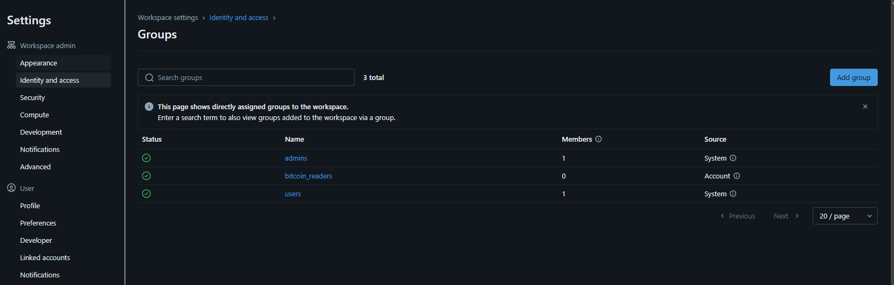

# Evidencias

## Ejecución de Gold

La salida de [04_load_gold.ipynb](../proceso/04_load_gold.ipynb) en Databricks muestra **1.461 filas** en `bitcoin_daily_metrics` y **5 filas** en `sentiment_summary`, en el esquema `catalog_smartdata.bitcoin_gold`.

- [Métricas diarias](gold_daily_metrics.png). Cálculo del retorno, rango intradía y día completo, seguido de la escritura de `bitcoin_daily_metrics`.
- [Resumen por sentimiento](gold_sentiment_summary.png). Agrupación por categoría y escritura de `sentiment_summary`.

El [informe de Power BI](../dashboard/README.md) incluye las capturas de Mercado y Sentimiento.

## Seguridad

El grupo `bitcoin_readers` figura como grupo de cuenta en el workspace.

